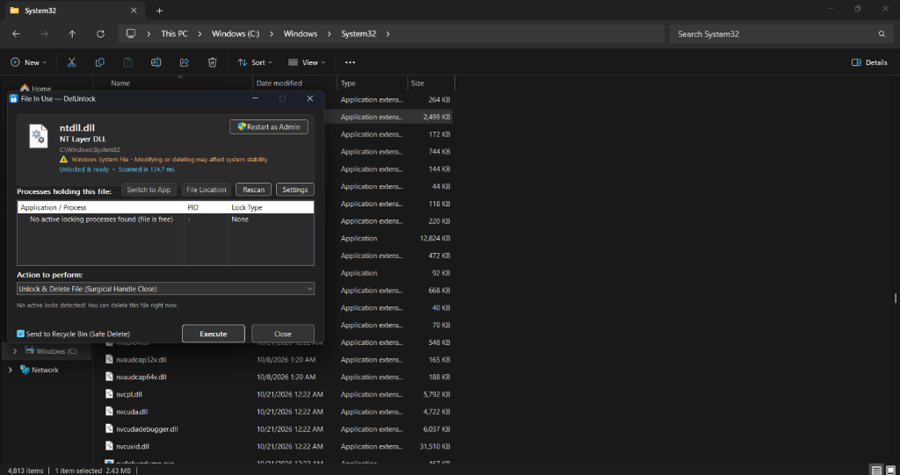
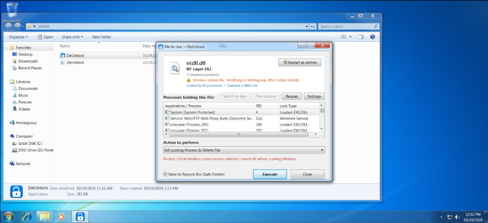
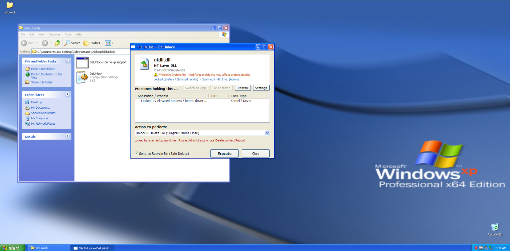

# DelUnlock

[](https://github.com/windows10hater/DelUnlock)
[](https://github.com/windows10hater/DelUnlock)
[](https://isocpp.org/)
[](LICENSE)

DelUnlock is a native Win32 C++ utility for identifying and removing file locks on Windows systems, from Windows XP (x86 and x64) through Windows 11. It compiles to a standalone, statically linked executable with no external dependencies or background services.

---

## Screenshots

### Windows 11 (Modern Dark Mode)


### Windows 7 (Aero Glass Interface)


### Windows XP Professional (Classic Luna Interface)


---

## Features

- **Lock Detection:**
  - Queries the Windows Restart Manager (Vista and newer) for processes holding file locks or memory-mapped sections.
  - Queries NT system handle tables (`NtQuerySystemInformation`) to identify exact handle values holding the target file.
  - Resolves handle names across background worker threads to avoid deadlocks on unresponsive named pipes or network drivers.

- **Lock Release and Deletion:**
  - Closes remote handles in the holding process using `DuplicateHandle` with `DUPLICATE_CLOSE_SOURCE`.
  - Supports process termination when handle closure is insufficient.
  - Supports scheduling files for deletion on the next reboot via `MoveFileExW` (`MOVEFILE_DELAY_UNTIL_REBOOT`).

- **Privilege and Service Handling:**
  - Detects if locking processes are managed by the Windows Service Control Manager.
  - Enables administrative privileges (`SeDebugPrivilege`, `SeTakeOwnershipPrivilege`, `SeBackupPrivilege`, `SeRestorePrivilege`) to inspect and release handles across process boundaries.
  - Overrides restrictive file access control lists (DACLs) when standard delete access is denied.

- **Batch Selection Handling:**
  - Uses an inter-process rendezvous mechanism (named mutex and memory mapping) so that multiple items selected in Windows Explorer consolidate into a single interface rather than spawning duplicate instances.

- **Native Interface:**
  - Adapts to the running environment: native Windows XP visual styles, Aero on Windows Vista and 7, and dark mode with rounded window corners on Windows 10 and 11.

- **Command-Line Interface:**
  - Supports scriptable operations via console commands for automated workflows.

---

## Comparison with Alternatives

| Feature | DelUnlock | LockHunter / IObit Unlocker | Sysinternals Process Explorer / Handle |
|:---|:---:|:---:|:---:|
| **Kernel Driver Required** | No (pure Win32 / NT API) | Yes (requires `.sys` driver) | Process Explorer loads driver on demand |
| **Windows XP Compatibility** | Yes (XP SP2 / SP3 / x64) | Drops older OS support | Newer builds require Vista or Win 8.1+ |
| **Explorer Context Menu** | Yes (one-click) | Yes | No (manual PID/handle search) |
| **Single Standalone Executable** | Yes (~290 KB, static CRT) | No (installer and service) | Yes |
| **Batch Multi-Select Consolidation** | Yes (IPC rendezvous) | No | No |
| **Anti-Cheat Friendly** | Yes (no kernel hooks) | Can conflict with anti-cheat | Diagnostic tool |

---

## Compatibility

DelUnlock is compiled targeting the NT 5.01 (x86) and NT 5.02 (x64) subsystems with internal polyfills for post-XP functions:

| Operating System | Architecture | Supported | Notes |
|:---|:---:|:---:|:---|
| Windows 11 | x64 / ARM64 | Yes | Native x64; ARM64 supported via Windows 11 emulation layer |
| Windows 10 | x64 / x86 | Yes | Dark titlebars and high-DPI scaling |
| Windows 8 / 8.1 | x64 / x86 | Yes | Standard desktop controls |
| Windows 7 | x64 / x86 | Yes | Aero styling and Restart Manager integration |
| Windows Vista | x64 / x86 | Yes | Restart Manager and UAC elevation |
| Windows XP (SP2 / SP3 / x64) | x64 / x86 | Yes | Native Luna styles with static CRT compatibility stubs |
| Windows Server 2003 to 2025 | x64 / x86 | Yes | Service detection and handle release |

---

## Usage

### Context Menu Integration

Register the right-click menu entry in Windows Explorer:

```cmd
:: Install Explorer context menu for files and directories
DelUnlock.exe --install

:: Remove context menu
DelUnlock.exe --uninstall
```

### Graphical Interface

Right-click any locked file or directory and choose **DelUnlock / Force Delete...**, or launch `DelUnlock.exe` directly to browse for a target.

Available actions:
1. `Unlock & Delete File (Surgical Handle Close)`: Closes matching file handles in the locking process and removes the file.
2. `Kill Locking Process & Delete File`: Terminates the locking process and removes the file.
3. `Unlock Only (Release Lock, Keep File)`: Closes file handles while leaving the target file intact.
4. `Kill Locking Process Only (Keep File)`: Terminates the locking process while leaving the target file intact.
5. `Delete File on Next Reboot`: Registers the file with Windows session manager for deletion at next startup.

### Command-Line Interface

DelUnlock can run directly from scripts or the command prompt:

```cmd
:: Close locking handles and delete file
DelUnlock.exe --delete "C:\Path\To\File.ext"

:: Terminate locking processes and delete file
DelUnlock.exe --kill-and-delete "C:\Path\To\File.ext"

:: Close file handles only
DelUnlock.exe --unlock "C:\Path\To\File.ext"

:: Queue for deletion upon next system reboot
DelUnlock.exe --reboot-delete "C:\Path\To\File.ext"

:: Suppress confirmation prompts
DelUnlock.exe --delete --force "C:\Path\To\File.ext"

:: Run internal benchmark and validation test
DelUnlock.exe --self-test
```

---

## Antivirus False Positives and Verification

Because DelUnlock interacts directly with remote process handles via `NtQuerySystemInformation`, takes administrative ownership privileges (`SeDebugPrivilege`), and severs handles via `DuplicateHandle`, automated heuristic scanners (such as Windows Defender or SmartScreen) may flag unsigned binaries as suspicious (often categorized generically as `Riskware` or `HackTool`).

DelUnlock contains no malware, no telemetry, and requires no external network access. The codebase is completely open source and can be compiled directly from source.

To verify binary integrity, official release checksums are published in `SHA256SUMS.txt` on the [GitHub Releases](https://github.com/windows10hater/DelUnlock/releases) page and listed below:

| Target Binary | Architecture | SHA-256 Checksum |
|:---|:---:|:---|
| `DelUnlock.exe` (or `DelUnlock-x64.exe`) | x64 | `3019CD8095E58BBCAC6F5CCDB1D050A07E9A692708617EF93E33D8EFCA8AF119` |
| `DelUnlock-x86.exe` | x86 | `CB81D55177A8E15D74258557933F66DB5AEAEC5B3AD67950D7C7EB00E4C775F3` |

To verify your downloaded executable locally in PowerShell:

```powershell
Get-FileHash -Algorithm SHA256 DelUnlock.exe
```

---

## Repository Structure

```
DelUnlock/
├── .github/
│   └── workflows/
│       └── build.yml       # GitHub Actions build and release pipeline
├── docs/
│   └── screenshots/        # Interface previews across Windows versions
├── res/
│   ├── app.ico             # Application icon
│   ├── app.manifest        # DPI and common controls manifest
│   └── resource.rc         # Win32 resource script
├── src/
│   ├── config.cpp          # Configuration file and registry verb handlers
│   ├── config.hpp
│   ├── main.cpp            # Application entry point, CLI parser, batch IPC
│   ├── ui.cpp              # Window management and visual layout
│   ├── ui.hpp
│   ├── unlocker.cpp        # Kernel handle scanner, service manager, handle operations
│   ├── unlocker.hpp
│   └── xp_compat.cpp       # Compatibility polyfills for Windows XP runtimes
├── .gitattributes          # Git line ending configuration
├── .gitignore              # Build artifact exclusions
├── build.bat               # MSVC build script (x64 and x86 targets)
├── LICENSE                 # Apache License 2.0
└── README.md               # Project documentation
```

---

## Building from Source

### Prerequisites
- Microsoft Visual C++ Compiler (`cl.exe`), available through Visual Studio or Visual C++ Build Tools.
- Windows SDK.

### Build Steps
From a developer command prompt, run:

```cmd
:: Build 64-bit binary (default):
build.bat x64

:: Build 32-bit binary:
build.bat x86
```

The script builds the binary with `/O2 /GL /std:c++17 /MT`, links against `/SUBSYSTEM:WINDOWS,5.02` (x64) or `5.01` (x86), and outputs the executable in the root directory.

---

## Safety Guardrails

- **Protected Processes:** Built-in safeguards reject termination requests targeting critical operating system processes, including `System`, `smss.exe`, `csrss.exe`, `wininit.exe`, `services.exe`, `lsass.exe`, and `winlogon.exe`.
- **System Directory Warnings:** Targets located within `%SystemRoot%` trigger explicit warning indicators in the interface.
- **Recycle Bin Support:** An optional soft-delete toggle routes deletions through the Windows Recycle Bin using `SHFileOperationW`.

---

## Disclaimer

DelUnlock includes features that forcibly modify system and process state. Please note the following:

- **Data Loss:** Forcibly closing a file handle inside a running application severs its access without warning. If that application was in the middle of writing data, the target file may become corrupted, and unsaved work in the application will be lost.
- **Process Instability:** Many applications do not handle sudden invalidation of open handles gracefully and may crash or hang after a handle is closed.
- **System Stability:** Forcibly terminating processes or modifying files used by background services or system components can destabilize the operating system.

This tool is provided "as is", without warranty of any kind. You are responsible for verifying the target file and locking application before initiating destructive operations.

---

## License

This project is licensed under the [Apache License, Version 2.0](LICENSE).
